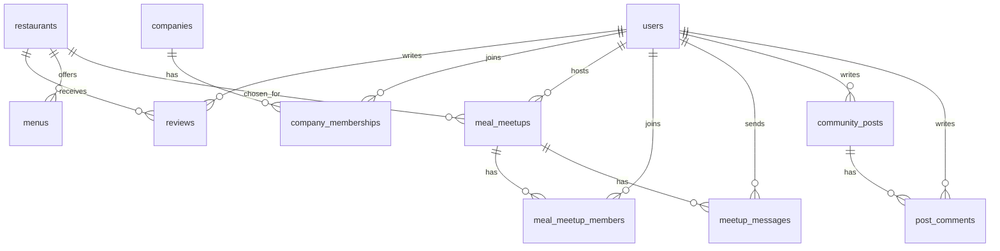

# 데이터베이스 구조

> PostgreSQL 16 + PostGIS / 스키마 `lunchpicker`  
> Flyway V1은 `restaurants`, V2는 사용자·리뷰·메뉴·모집 등 업무 테이블, V3은 식당 출처 컬럼, V4는 2026-09 공공데이터 음식점 초기 데이터를 생성한다. V5~V7은 로그인·리뷰·지역 글에 필요한 변경을 기록하고 V8은 모집 채팅 메시지, V9는 지역 글 조회수·댓글을 만든다.

## 관계

## 1. 음식점

### `restaurants` — 음식점

| 컬럼 | 타입 | 제약·의미 |
| --- | --- | --- |
| `id` | `BIGINT` | PK, identity |
| `name` | `TEXT` | NOT NULL, 음식점 이름 |
| `location` | `geography(Point,4326)` | NOT NULL, WGS84 위치(경도·위도) |
| `source_name` | `VARCHAR(20)` | NULL 허용, 공공데이터는 `sbiz` |
| `source_id` | `VARCHAR(40)` | NULL 허용, 제공처의 상가업소번호 |
| `address` | `TEXT` | NULL 허용, 도로명 또는 지번 주소 |
| `category` | `VARCHAR(100)` | NULL 허용, 상권업종소분류명 |
| `source_snapshot_date` | `DATE` | NULL 허용, 제공 파일 기준일 |

- `location`에 GiST 인덱스가 있다. 반경 검색은 `ST_DWithin`을 사용하고 거리는 미터로 계산한다.
- `(source_name, source_id)`는 UNIQUE이며 둘 다 NULL이거나 둘 다 값이 있어야 한다. 같은 이름의 다른 지점이 있을 수 있어 `name`에는 UNIQUE를 두지 않는다.
- V4는 서울·경기 상가정보에서 두 역 3 km 안의 식사 업소를 적재한다. 데이터 출처는 [소상공인시장진흥공단 상가(상권)정보](https://www.data.go.kr/data/15083033/fileData.do)다. 원본의 영업 상태·업종 분류가 실제와 다를 수 있으므로 이용자 화면에서 최신 영업 정보를 보장하지 않는다.

## 2. 사용자와 리뷰

### `users` — 사용자

| 컬럼 | 타입 | 제약·의미 |
| --- | --- | --- |
| `id` | `BIGINT` | PK, identity |
| `display_name` | `VARCHAR(40)` | NOT NULL, 앱에 표시할 이름 |
| `created_at` | `TIMESTAMPTZ` | NOT NULL, 가입 시각 |
| `updated_at` | `TIMESTAMPTZ` | NOT NULL, 프로필 수정 시각 |

로그인 제공자와 외부 사용자 ID 저장 방식은 인증 수단을 정할 때 확정한다. 비밀번호를 사용한다면 평문이 아닌 해시만 저장한다. 회사 이메일은 회사 인증 기능을 구현할 때 추가한다.

### `reviews` — 방문 후기

| 컬럼 | 타입 | 제약·의미 |
| --- | --- | --- |
| `id` | `BIGINT` | PK, identity |
| `restaurant_id` | `BIGINT` | NOT NULL, `restaurants.id` FK |
| `author_id` | `BIGINT` | NOT NULL, `users.id` FK |
| `rating` | `SMALLINT` | NOT NULL, `CHECK (rating BETWEEN 1 AND 5)` |
| `body` | `TEXT` | NOT NULL, 리뷰 내용 |
| `created_at` | `TIMESTAMPTZ` | NOT NULL, 작성 시각 |
| `updated_at` | `TIMESTAMPTZ` | NOT NULL, 수정 시각 |

- 음식점 리뷰 목록용 인덱스: `(restaurant_id, created_at DESC, id DESC)`.
- 한 사람이 같은 음식점에 여러 번 리뷰를 쓸 수 있는지, 탈퇴·삭제 시 리뷰를 어떻게 처리할지는 리뷰 기능 구현 전에 결정한다. 그때 UNIQUE와 삭제 정책을 확정한다.

## 3. 메뉴

### `menus` — 음식점 메뉴

| 컬럼 | 타입 | 제약·의미 |
| --- | --- | --- |
| `id` | `BIGINT` | PK, identity |
| `restaurant_id` | `BIGINT` | NOT NULL, `restaurants.id` FK |
| `name` | `VARCHAR(100)` | NOT NULL, 메뉴명 |
| `price_krw` | `INTEGER` | NULL 허용, 알 수 있는 경우 `CHECK (price_krw >= 0)` |
| `updated_at` | `TIMESTAMPTZ` | NOT NULL, 마지막 확인 시각 |

`restaurant_id`에 인덱스를 둔다. 메뉴 가격과 판매 여부는 변경될 수 있으므로 데이터 출처와 갱신 정책이 정해진 후 적재한다.

## 4. 회사 소속

### `companies` — 회사 위치

| 컬럼 | 타입 | 제약·의미 |
| --- | --- | --- |
| `id` | `BIGINT` | PK, identity |
| `name` | `VARCHAR(120)` | NOT NULL, 회사명 |
| `location` | `geography(Point,4326)` | NOT NULL, 회사 위치 |
| `created_at` | `TIMESTAMPTZ` | NOT NULL, 등록 시각 |

`location`에 GiST 인덱스를 둔다. 회사명만으로 같은 회사를 식별하지 않는다.

### `company_memberships` — 사용자·회사 소속

| 컬럼 | 타입 | 제약·의미 |
| --- | --- | --- |
| `user_id` | `BIGINT` | `users.id` FK, 복합 PK |
| `company_id` | `BIGINT` | `companies.id` FK, 복합 PK |
| `verification_status` | `VARCHAR(20)` | NOT NULL, 인증 상태 |
| `joined_at` | `TIMESTAMPTZ` | NOT NULL, 소속 신청 시각 |
| `verified_at` | `TIMESTAMPTZ` | NULL 허용, 인증 완료 시각 |

`company_id`에 조회 인덱스를 둔다. 인증 상태 값과 복수 회사 소속 허용 여부는 인증 흐름을 설계할 때 확정한다.

## 5. 같이 먹기

### `meal_meetups` — 식사 모집

| 컬럼 | 타입 | 제약·의미 |
| --- | --- | --- |
| `id` | `BIGINT` | PK, identity |
| `host_user_id` | `BIGINT` | NOT NULL, `users.id` FK |
| `restaurant_id` | `BIGINT` | NOT NULL, `restaurants.id` FK |
| `starts_at` | `TIMESTAMPTZ` | NOT NULL, 식사 시작 시각 |
| `capacity` | `SMALLINT` | NOT NULL, `CHECK (capacity >= 2)` |
| `status` | `VARCHAR(20)` | NOT NULL, 모집 상태 |
| `created_at` | `TIMESTAMPTZ` | NOT NULL, 생성 시각 |

지역·시간 목록용 인덱스는 실제 조회 조건에 맞춰 추가한다.

### `meal_meetup_members` — 모집 참여자

| 컬럼 | 타입 | 제약·의미 |
| --- | --- | --- |
| `meetup_id` | `BIGINT` | `meal_meetups.id` FK, 복합 PK |
| `user_id` | `BIGINT` | `users.id` FK, 복합 PK |
| `joined_at` | `TIMESTAMPTZ` | NOT NULL, 참여 시각 |

`user_id`에도 인덱스를 둔다. 모집자는 참여자에 포함한다. 정원 초과 방지는 단순 `CHECK`로 해결되지 않으므로 서비스의 트랜잭션과 동시성 제어로 처리한다.

### `meetup_messages` — 모집별 채팅

| 컬럼 | 타입 | 제약·의미 |
| --- | --- | --- |
| `id` | `BIGINT` | PK, identity |
| `meetup_id` | `BIGINT` | NOT NULL, `meal_meetups.id` FK |
| `sender_id` | `BIGINT` | NOT NULL, `users.id` FK |
| `body` | `TEXT` | NOT NULL, 1~1000자 |
| `created_at` | `TIMESTAMPTZ` | NOT NULL, 작성 시각 |

`(meetup_id, id)` 인덱스로 마지막 메시지 ID 이후를 조회한다. 읽기·쓰기 권한은 API에서 현재 모집 참여 여부로 검증한다.

## 6. 지역 글과 댓글

`community_posts`는 작성자, 1~100자의 필수 제목, 본문, WGS84 지역 좌표, 선택적 식당, 작성 시각과 `view_count`를 저장한다. V10은 기존 글의 본문 첫 줄을 제목으로 채운다. 조회수는 상세 화면 진입 요청에서 DB의 원자적 증가 쿼리로 변경한다.

| `post_comments` 컬럼 | 타입 | 제약·의미 |
| --- | --- | --- |
| `id` | `BIGINT` | PK, identity |
| `post_id` | `BIGINT` | 글 FK, 글 삭제 시 함께 삭제 |
| `author_id` | `BIGINT` | 작성자 FK |
| `body` | `TEXT` | NOT NULL, 1~1000자 |
| `created_at` | `TIMESTAMPTZ` | NOT NULL, 작성 시각 |

`(post_id, created_at DESC, id DESC)` 인덱스로 글별 최신 댓글을 조회한다. 댓글 작성·삭제 권한은 서버가 로그인 토큰의 작성자 ID로 검사한다.

## 도입 원칙

V11의 `restaurant_favorites`는 `(user_id, restaurant_id)`를 기본키로 사용해 중복 찜을 막는다. `restaurant_detail_views`는 식당별 상세 진입 시각을 저장하며 인기순은 최근 30일 기록만 센다. 각 식당 ID에 인덱스를 두어 정렬 집계에 사용한다.

- FK가 참조하는 컬럼과 자주 쓰는 조회 조건에 인덱스를 둔다. PostgreSQL은 FK의 참조 **대상**에는 PK/UNIQUE 인덱스를 요구하지만, FK가 놓인 **자식 컬럼**의 인덱스를 자동 생성하지는 않는다.
- 시각은 `TIMESTAMPTZ`로 저장하고 앱에서 Asia/Seoul 기준으로 표시한다.
- 개인용 돌림판은 현재 화면의 후보를 섞는 기능이라 테이블이 필요 없다. 공유 결과·이력 보관이 필요해질 때 별도로 설계한다.
- 투표, 쿠폰, 사장님 소유권, 신고 테이블은 해당 기능의 규칙을 정한 뒤 설계한다.

참고: [PostgreSQL 제약·FK](https://www.postgresql.org/docs/16/ddl-constraints.html), [PostgreSQL 날짜·시간 타입](https://www.postgresql.org/docs/16/datatype-datetime.html), [PostGIS 반경 조회](https://postgis.net/documentation/tips/st-dwithin/).
