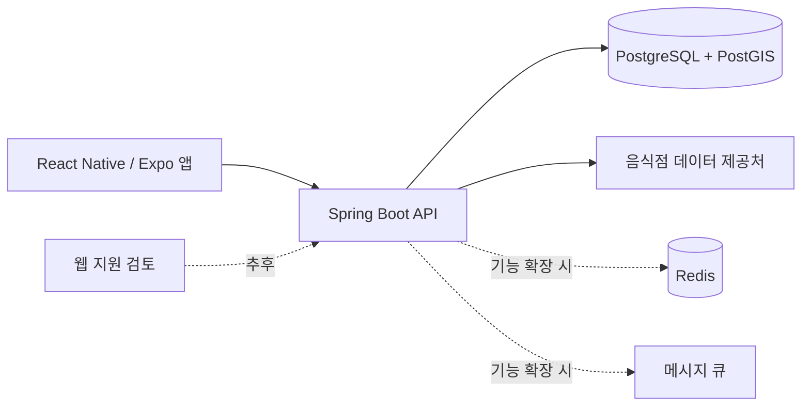

# 오늘의 점심 저녁 메뉴는? — 프로젝트 기획서

> 2026년 11월 7일 · @roadin이 제공한 구상 정리  
> 상태: 식당 조회·리뷰, 로그인, 지역 글, 같이 먹기 모집, 모집별 채팅의 첫 흐름을 구현했습니다. 아래 확장 후보 중 구현되지 않은 항목은 확정 사양이 아닙니다.

## 1. 서비스 개요

회사 위치를 기준으로 일정 반경 안의 직장인들이 점심·저녁 메뉴를 함께 고르는 서비스다. 주변 음식점을 찾고 리뷰를 남기며, 돌림판으로 메뉴를 결정할 수 있다. 목표는 매일 반복되는 메뉴 고민을 줄이고 회사 근처의 새로운 음식점을 발견하도록 돕는 것이다.

- 대상: 같은 업무 지역에서 식사 장소를 찾는 직장인
- 기술 방향: Java / Spring Boot, React Native / Expo, PostgreSQL + PostGIS
- 초기 앱 형태: Android·iOS 모바일 앱
- 초기 대상 지역: 남위례 인근, 가락동 인근
- 첫 검색 중심점: 남위례역(37.462820, 127.139170), 가락시장역(37.493060, 127.118060), 각 반경 3 km
- 역 중심 좌표 출처: [남위례역](https://www.findlatlng.org/place/namwirye), [가락시장역](https://www.findlatlng.org/place/garak-market) (WGS84)
- 미정: 추가 외부 음식점 데이터 계약 및 사용 범위

### 핵심 기능

| 기능 | 내용 |
| --- | --- |
| 회사 위치 기반 소통 | 회사 위치를 지정하고 일정 반경 안의 직장인들과 메뉴를 이야기한다. |
| 주변 음식점 목록 | 외부 API·공공데이터를 활용하고 사장님의 직접 등록으로 보완한다. |
| 음식점 리뷰 | 주변 직장인이 방문 경험과 평가를 남긴다. |
| 돌림판 | 후보 음식점을 넣고 결과를 뽑는다. |

### 초기 사용자 확보 시 고려할 점

반경 3 km 안의 사용자가 적으면 소통 화면이 비어 보일 수 있다. 초기 대상 지역인 남위례와 가락동 인근에서 시작하고, 음식점 목록·돌림판처럼 혼자서도 쓸모 있는 기능부터 제공하는 방향을 검토한다.

## 2. 기능 확장 후보

아래 항목은 원안의 제안 목록이다. 출시 범위와 우선순위는 별도로 결정한다.

| 기능 | 목적·예시 |
| --- | --- |
| 회사 인증 | 회사 이메일 도메인 인증으로 근처 직장인에 대한 신뢰를 높이고 홍보성 리뷰를 줄인다. |
| 같이 먹기 모집 | “12시 ○○국밥 2명 구해요”처럼 정원을 정해 모집한다. |
| 반경 기반 채팅·메뉴 투표 | 주변 사용자와 대화하고 투표로 메뉴를 정한다. |
| 공유 돌림판 | 여러 명이 같은 결과를 본다. 서버가 결과를 결정해 전달한다. |
| 사장님 계정 | 오늘의 메뉴·점심 특가 등록과 리뷰 답글을 제공한다. |
| 선착순 쿠폰 | 발급 수량이 정해진 할인 쿠폰으로 가게 홍보와 사용자 유입을 돕는다. |
| 방문 인증 리뷰 | 영수증이나 위치 확인으로 리뷰 신뢰도를 높인다. |
| 필터 | 가격대, 도보 거리, 혼밥 가능 여부 등으로 음식점을 좁힌다. |
| 추천 보조 | 최근 먹은 메뉴를 제외하거나 날씨를 반영한다. |
| 지역 인기 메뉴 | 특정 시간대에 주변에서 인기 있는 메뉴를 보여준다. |
| 점심 알림 | 점심시간 전 모집 현황 등을 알려준다. |
| 검색 개선 | 한글 초성 및 오타 검색을 지원한다. |
| AI 기능 | 리뷰 요약, 자연어 음식점 검색을 제공한다. |
| 운영 도구 | 신고, 욕설 필터, 관리자 화면을 제공한다. |

## 3. 음식점 데이터 확보

| 소스 | 검토 용도 | 확인 사항 |
| --- | --- | --- |
| [소상공인시장진흥공단 상가(상권)정보](https://www.data.go.kr/data/15083033/fileData.do) | 서울·경기 음식점 초기 데이터 적재 | 분기별 갱신과 업종·영업 상태 품질 확인 |
| 카카오 로컬 API | 필요할 때 실시간 장소 조회 후보 | 호출 제한, 저장·표시·가공 조건 |
| 네이버 지역검색 API | 보조 검색 소스 | 결과 수 제한, 저장·표시 조건 |
| 사장님 직접 등록 | 메뉴·가격·특가 등 최신 정보 보완 | 중복 가게 확인과 소유권 검증 |

공공데이터 파일의 2026-09-30 기준 자료를 두 역 3 km 범위로 적재했다. 외부 지도 API는 자체 DB 적재 목적으로 사용하지 않는다. 새 데이터 사용 전에 각 제공처의 최신 약관을 확인한다.

## 4. 앱 방향

React Native와 Expo로 Android·iOS 앱부터 만든다. Expo Router로 화면 이동을 구성하고, Expo SDK 모듈을 필요한 기능에 맞춰 추가한다. 웹 지원은 초기 앱을 만든 뒤 필요성을 확인한다. 백엔드는 모바일 앱이 사용하는 Spring Boot API로 둔다.

| 방식 | 기대 효과 | 고려 사항 |
| --- | --- | --- |
| 반응형 웹 + PWA | 하나의 웹 코드베이스로 빠르게 시작 | 현재는 모바일 앱 우선 방향 |
| Capacitor | React 웹 코드 재사용 | 웹뷰의 사용감과 플랫폼 연동 |
| React Native (Expo) | 하나의 TypeScript 앱으로 Android·iOS 지원, Expo SDK 모듈 활용 | 웹 화면은 별도 설계가 필요할 수 있음 |
| Flutter | 모바일 UI·성능 선택지 | Dart 학습과 별도 코드베이스 |

저장소 구성:

```text
lunch-picker/
├── build.gradle        Spring Boot 백엔드
├── src/                백엔드 소스
└── apps/
    └── mobile/         React Native (Expo)
```

현재 Spring Boot 프로젝트는 저장소 루트에 있고 Expo 앱은 `apps/mobile/`에 있다. 공통 API 타입은 API 명세를 도입할 때 별도 패키지로 분리할 수 있다.

모바일 앱은 상단 지역 선택과 검색·알림·메뉴 버튼, 하단 홈·커뮤니티·지도·채팅·마이 탭을 사용한다. 홈의 3 km 음식점 목록, 이름 검색, 가격대 슬라이더와 기본·찜·최근 30일 인기순 정렬, 식당 상세·찜, 지도 마커, 개인용 돌림판이 연결되어 있다. 돌림판 후보는 앱 세션 동안만 유지한다. 커뮤니티는 제목이 있는 지역 글 목록·작성·상세·수정·삭제, 조회수·댓글과 같이 먹기 모집·참여를 제공한다. 채팅은 참여한 모집별 메시지 저장과 5초 간격 조회로 동작한다. 알림은 준비 중 화면이다. 마이 탭에서는 로그인 상태를 확인할 수 있다.

앱 도입 시 함께 검토할 항목:

- 모바일 보안 저장소의 토큰 보관과 Refresh Token Rotation
- `/api/v1` 같은 API 버전 관리와 이전 앱 버전의 호환성
- Spring OpenAPI 명세에서 TypeScript 클라이언트 생성
- 초대 링크를 앱 또는 웹으로 여는 딥링크

## 5. 시스템 구성 구상

원안의 포함된 다이어그램은 텍스트에 실리지 않아, 설명을 기준으로 구성 요소만 다시 정리했다.



PostGIS는 반경 검색과 거리순 정렬을 위한 핵심 저장소 후보이다. 검색은 처음에 PostgreSQL로 시작하고, 검색 규모와 요구가 커질 때 별도 검색 엔진을 검토한다.

## 6. 구현·학습 주제

아래 항목은 기능을 만들면서 다룰 수 있는 기술 과제다. 모든 기술을 초기 버전에 도입한다는 의미는 아니다.

| 분야 | 주제 | 서비스 안의 상황 |
| --- | --- | --- |
| 데이터 | 공간 검색 | 반경 검색·거리 정렬, PostGIS `ST_DWithin` 및 GiST 인덱스 |
| 데이터 | JPA 성능 | N+1, 리뷰 목록의 커서 페이지네이션, 인덱스 설계 |
| 실시간 | WebSocket / STOMP | 채팅, 모집 현황, 공유 돌림판 결과 전달 |
| 실시간 | 서버 확장 | 서버 여러 대 사이 메시지 전달, Redis Pub/Sub 후보 |
| 동시성 | 모집 정원 | 마지막 1자리에 동시 신청할 때의 원자적 처리와 락 전략 |
| 동시성 | 집계 | 리뷰 평균 별점·좋아요 수의 동시 갱신 |
| 동시성 | 선착순 쿠폰 | 재고 차감, 중복 발급 방지, Redis 원자 연산·대기열 후보 |
| 동시성 | 실시간 순위 | Redis Sorted Set과 시간 단위 집계 후보 |
| 트래픽 | 점심 피크 | 11시 30분~12시 집중 요청, 캐시, k6 부하 테스트, 커넥션 풀 |
| 트래픽 | 캐시 | 인기 음식점 캐시 및 리뷰 변경 시 무효화 |
| 트래픽 | 요청 제한 | 도배 방지, 토큰 버킷, Bucket4j + Redis 후보 |
| 비동기 | 도메인 이벤트 | 리뷰 작성 후 평점 재계산·알림 분리 |
| 비동기 | 메시지 신뢰성 | 메시지 큐와 Outbox 패턴 검토 |
| 비동기 | 푸시 알림 | FCM/APNs, 예약 작업, 대량 발송 처리 |
| 비동기 | 분산 스케줄링 | 여러 서버의 데이터 동기화 중복 실행 방지 |
| 외부 연동 | API 안정성 | 호출 제한, 재시도, 서킷 브레이커 후보 |
| 외부 연동 | 이미지 업로드 | Presigned URL, 비동기 썸네일 생성, CDN 후보 |
| 보안 | 인증·인가 | OAuth2 로그인, 역할별 권한, 이메일 인증 |
| 보안 | 돌림판 공정성 | 공유 결과를 서버에서 결정하고 참여자에게 전달 |
| 검색·추천 | 한글 검색 | `pg_trgm` 검토 후 필요하면 Elasticsearch + nori 검토 |
| 검색·추천 | 취향 추천 | 협업 필터링, pgvector 유사도 검색 후보 |
| 검색·추천 | AI 연동 | LLM API, 결과 캐시와 비용 관리 |
| 운영 | 배포 | 무중단 배포와 WebSocket 연결 처리 |
| 운영 | 관측성 | Prometheus, Grafana, OpenTelemetry 후보 |
| 운영 | 테스트 | Testcontainers로 PostgreSQL·PostGIS 통합 테스트 |
| 운영 | 모더레이션 | 신고, 욕설 필터, 소프트 삭제, 감사 로그 |
| 운영 | 행동 분석 | 이벤트 로깅과 간단한 A/B 테스트 |

포트폴리오 관점에서는 같이 먹기 모집, 공유 돌림판, 선착순 쿠폰이 동시성·실시간 처리를 다루기 좋다. 특히 쿠폰의 동시성 제어와 메시지 발행의 신뢰성을 설명할 수 있다.

## 7. 출시 전 확인 사항

- 위치정보 관련 법규: 회사 주소만 사용하는지, 실시간 GPS를 처리하는지에 따라 적용 요건을 확인한다.
- 개인정보 처리: 회사 이메일과 위치 관련 데이터의 수집 목적, 보관, 접근 제한, 탈퇴 후 파기 정책을 정한다.
- 외부 데이터 이용: 각 API·공공데이터의 저장, 가공, 재배포 및 표시 조건을 확인한다.
- 커뮤니티 운영: 신고 처리, 홍보성 게시물과 악성 리뷰 대응 방침을 정한다.

## 8. 다음 결정 사항

1. 남위례역·가락시장역 중심 3 km로 시작한다. 실제 서비스에 맞는 반경은 사용 후 조정한다.
2. 첫 버전에서 제공할 기능과 소통 기능의 도입 시점을 정한다.
3. 음식점 데이터의 갱신 주기와 잘못 분류된 업소의 정정 흐름을 정한다.
4. 사용자·회사·사장님 인증 범위를 정한다.
5. 첫 버전의 화면 흐름과 API·데이터 모델을 설계한다.

## 9. 데이터베이스 테이블

컬럼·관계·제약은 [데이터베이스 구조](DATABASE_DESIGN.md)에 기록한다.

Flyway V1은 `restaurants`, V2는 사용자·리뷰·메뉴·회사·식사 모집 관련 7개 테이블, V3은 식당 출처 컬럼, V4는 공공데이터 초기 식당을 생성한다. `flyway_schema_history`는 Flyway가 관리한다. 테이블이 생성된 것과 해당 기능의 API가 구현된 것은 별개다.

| 단계 | 테이블 | 주요 데이터 | 도입 이유 |
| --- | --- | --- | --- |
| V1·V3·V4 | `restaurants` | `id`, `name`, `location`, 출처·주소·분류 | 식당 위치와 3 km 반경 검색·공공데이터 초기 적재 |
| V2 | `users` | `id`, `display_name`, 생성·수정 시각 | 리뷰 작성자 식별 |
| V2 | `reviews` | `id`, `restaurant_id`, `author_id`, 평점, 내용, 작성 시각 | 식당별 방문 후기 |
| V2 | `menus` | `id`, `restaurant_id`, 메뉴명, 가격 | 메뉴 정보 저장 |
| V2 | `companies`, `company_memberships` | 회사 위치, 사용자 소속·인증 상태 | 회사 소속 정보 저장 |
| V2 | `meal_meetups`, `meal_meetup_members` | 식당, 시간, 정원, 참여자 | 식사 모집 정보 저장 |

개인용 돌림판이 화면 안의 후보만 섞는다면 별도 테이블이 필요 없다. 결과 공유·기록 기능을 만들 때 세션과 후보 테이블을 추가한다. 식당의 제공처 식별자와 중복 방지 제약은 V3에 추가했다. 인증 방식, 리뷰 수정 정책, 회사 인증 방식이 정해지면 관련 컬럼·제약을 추가한다.

## 로그인·지역 글·리뷰 진행 상태

- 로그인은 이메일 대신 고유한 로그인 아이디(`loginId`)와 비밀번호를 사용한다. `users.id`는 DB 내부 숫자 키다.
- 커뮤니티는 회사 소속 인증 없이 개인이 지역 글을 쓴다. 3 km 목록·작성 API와 React Native 커뮤니티 탭·글쓰기 화면, 선택적 식당 자동완성을 구현했다. 식사 시간 입력은 아직 제공하지 않는다.

- 식당 리뷰: 기존 `reviews` 테이블을 사용해 식당별 최신순 페이지 조회, 로그인 사용자 작성, 작성자 전용 수정·삭제 API와 모바일 상세 화면을 연결했다.
